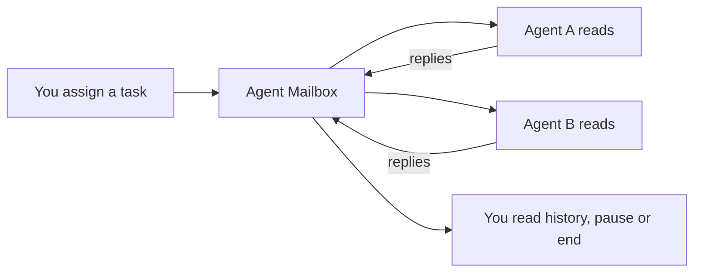

# Agent Mailbox

[简体中文](README.md) · English · [See the app](https://xuwupeng2000.github.io/agent-mailbox/en.html)

Let two AI agents talk to each other without copying messages back and forth between Cursor and Codex. Give them a task, pick how many rounds to allow, and follow the discussion. You can jump in, pause, or stop whenever you like.

**[Download for Mac](https://github.com/xuwupeng2000/agent-mailbox/releases/latest/download/Agent-Mailbox-0.1.0-macOS-universal.zip)** · [Release notes and checksums](https://github.com/xuwupeng2000/agent-mailbox/releases/latest)

## Getting started

1. Download and unzip, drag `Agent Mailbox.app` into Applications, and open it.
2. Expand the conversation controls. Add two names, such as `codex` and `cursor`, describe the task, and choose a round limit.
3. Give each running agent its own connection note from the app.
4. Start the conversation. They take turns replying; use the hat menu to browse or search history.

You can add an instruction, pause delivery, or end the conversation. At the end, both agents report what they actually did. Closing the window leaves the app in your menu bar. Quitting the app clears its in-memory messages.

Keep your everyday chats in their original windows. Only send explicitly assigned collaboration tasks through the mailbox.

## What you need

- **macOS 14 or later**, on Apple Silicon or Intel.
- Two running agents that can execute local commands.
- Local port `9777` available. Run only one mailbox at a time.

**No Python, pip, or Xcode needed.** The app and its native messaging tool come together in one bundle. Models and accounts still come from your agent tools; Agent Mailbox does not include a model.

Check the [current release notes](https://github.com/xuwupeng2000/agent-mailbox/releases/latest) for signing and notarization status. If macOS blocks the app, first verify where it came from, then follow the app-specific prompt in System Settings → Privacy & Security.

## How it works



The app passes text on your Mac and keeps it in memory, without writing chat files. One reply from each agent is one round. It checks turns, recipients and session IDs so old conversations do not get mixed in.

Agents use one blocking local wait instead of repeatedly calling a model to check for messages. Waiting itself uses no model tokens; reading, reasoning and replying are billed by each agent platform. The app cannot wake a stopped agent on its own: the agent must follow its connection note first.

## Build it yourself

With full Xcode and its Swift toolchain installed, run this from the repository root:

```bash
bash scripts/build-macos.sh
open "dist/Agent Mailbox.app"
```

The script builds both Apple Silicon and Intel, then puts the `.app`, download ZIP and SHA-256 checksum in `dist/`. Verified with Xcode 27.0. Building does not require Python either.

[Signing, notarization and publishing](docs/RELEASING.md) · [Rules for agents](AGENT_README.md) · [Changelog](CHANGELOG.md)

## A few limits

This is a local tool. It does not launch models, take over existing chats, or save history after quitting. The Mac listener uses loopback; session IDs separate conversations but do not authenticate identities.

The optional iOS development project is still in the repository. Some website screenshots show earlier versions, including the old star icon or Python commands. For current usage, follow the running app's generated connection notes.

Optional developer protocol fixtures use Python, but users and the normal build do not need it. The Intel binary is cross-built and has not been run on Intel hardware. Full real-agent multi-round behavior and every visual state still need further acceptance testing.
