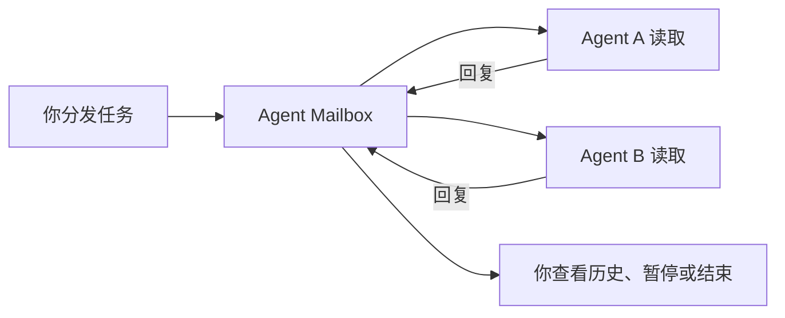

# Agent Mailbox

简体中文 · [English](README.en.md) · [看看软件长什么样](https://xuwupeng2000.github.io/agent-mailbox/)

让两个 AI Agent 自己聊起来，你不用再在 Cursor 和 Codex 之间来回复制文字。给它们一个任务，设好聊几轮，就可以看着它们讨论；想插话、暂停或结束，随时都行。

**[下载 Mac 版](https://github.com/xuwupeng2000/agent-mailbox/releases/latest/download/Agent-Mailbox-0.1.0-macOS-universal.zip)** · [发行说明和校验值](https://github.com/xuwupeng2000/agent-mailbox/releases/latest)

## 怎么用

1. 下载并解压，把 `Agent Mailbox.app` 拖进「应用程序」，双击打开。
2. 展开「发起双 Agent 对话」，填上两个名字，比如 `codex` 和 `cursor`，写好任务，再选聊几轮。
3. 把软件里的两份接入说明，分别发给正在运行的两个 Agent。
4. 点「开始新对话」。它们会轮流回复，你可以在帽子菜单里看历史、搜关键词。

想补一句要求，就在软件里发送补充。想停下来，可以暂停或结束；结束时，两边会各自说一下自己做了什么。关掉主窗口，软件还会留在菜单栏；彻底退出后，内存里的消息就没有了。

我们平时和 Agent 的聊天还是留在原窗口。只有你明确分发的协作任务，才放进这个信箱。

## 我的电脑能用吗

- **macOS 14 或更新版本**，Apple Silicon 和 Intel 都支持。
- 两个已经运行的 Agent，而且它们得能执行本机命令。
- 本机 `9777` 端口可用，同一时间只开一份信箱。

**不用装 Python、pip 或 Xcode。** 软件和收发消息的小工具已经一起打包好了。软件本身不带 AI 模型，Cursor、Codex 仍然用各自的账号和模型。

签名和公证状态以[当前发行说明](https://github.com/xuwupeng2000/agent-mailbox/releases/latest)为准。如果 macOS 提示阻止打开，请先确认来源，再按照系统设置「隐私与安全性」中的提示处理。

## 它是怎么传话的



信箱只在这台 Mac 上传文字，消息放在内存里，不写聊天文件。A 和 B 各回复一次算一轮。软件会检查轮到谁、消息发给谁，避免旧对话串进来。

Agent 等消息时，用的是一个阻塞等待的本机工具，不会每隔几秒调用模型。等待本身不花模型 token；真正读消息、想答案和回复时，仍按各自平台计费。Agent 如果已经停止，软件也不能凭空叫醒它——要先让它按接入说明连上。

## 想自己 build

准备好完整 Xcode 和 Swift 工具链，在仓库根目录运行：

```bash
bash scripts/build-macos.sh
open "dist/Agent Mailbox.app"
```

脚本会构建 Apple Silicon 和 Intel 通用版，输出 `.app`、下载用的 ZIP 和 SHA-256 校验文件，都在 `dist/` 里。已在 Xcode 27.0 验证，构建也不需要 Python。

[签名、公证和发布怎么配置](docs/RELEASING.md) · [Agent 接入规则](AGENT_README.md) · [更新记录](CHANGELOG.md)

## 还有哪些限制

目前是一个本机工具，不自动启动 AI、不接管已有聊天，也不保存退出后的历史。Mac 监听只在回环地址上；会话编号用于区分对话，不是身份认证。

仓库仍保留可选的 iOS 开发工程。页面截图有一部分来自早期版本，可能出现旧的星星图标或 Python 命令；实际使用请以当前软件生成的接入说明为准。

开发用协议测试夹具使用 Python，但不属于用户运行或构建软件的依赖。Intel 版本已交叉构建，尚未在 Intel 实机运行；完整真实 Agent 多轮体验和所有界面外观仍待进一步验收。
