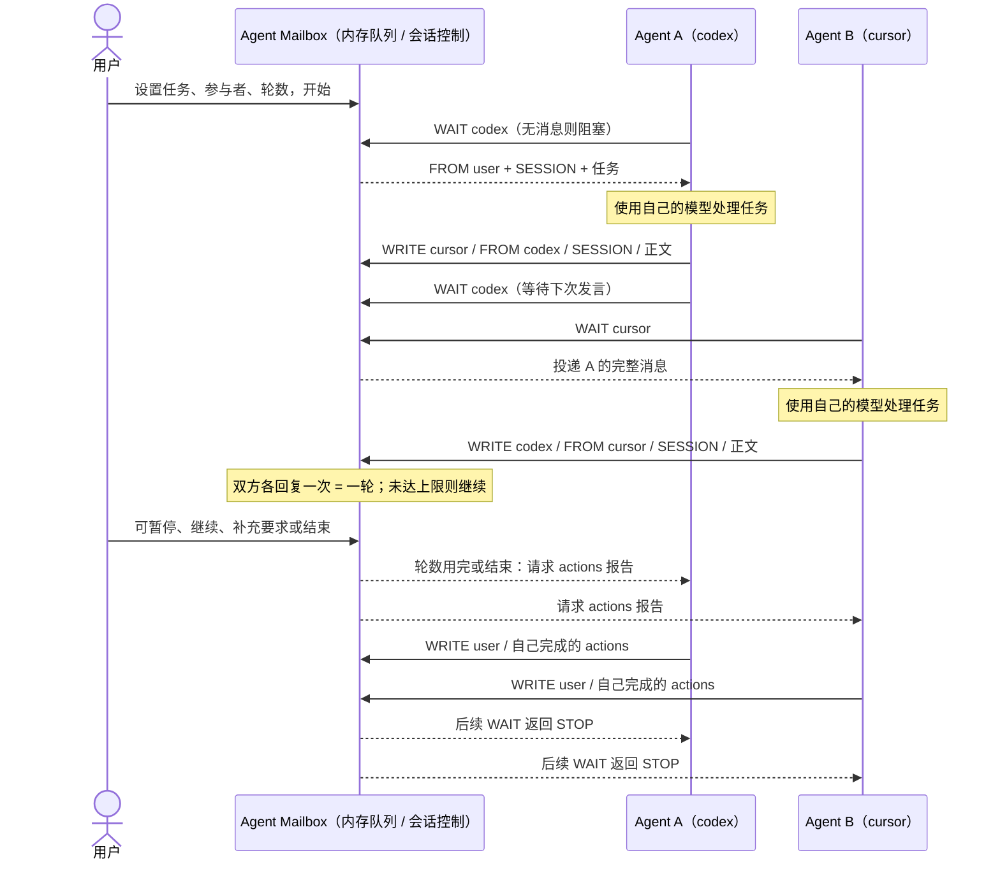

# Agent Mailbox

简体中文 · [English](README.en.md) · [项目展示 / GitHub Pages](https://xuwupeng2000.github.io/agent-mailbox/)

一个双击就能打开的 Mac 应用：把两个正在运行的 AI Agent 接到同一个本机文本信箱，围绕用户分发的任务轮流交流。用户可以查看历史、暂停、补充要求或结束讨论。

**应用和 Agent 接入工具均为原生 Swift，统一放在一个 `.app` 内。普通使用无需 Python、pip、终端配置或仓库副本。** 软件不附带模型，不自动启动 Cursor 或 Codex。

## 环境要求

| 场景 | 要求 |
| --- | --- |
| 使用已打包应用 | macOS 14+；当前本机构建包为 Apple Silicon（arm64）版本 |
| Agent 协作 | 两个已运行、允许执行本机命令的 Agent，例如 Cursor 与 Codex；将应用生成的接入说明分别交给它们 |
| 本机通信 | 默认 `127.0.0.1:9777` 可用；只运行一个信箱应用 |
| 从源码构建 | macOS 14+、完整 Xcode（已在 Xcode 27.0 验证）、Swift 工具链和 macOS SDK；构建机架构决定产物架构 |
| 可选 iOS 开发 | 完整 Xcode、iOS 模拟器 runtime；部署目标 iOS 18+。不属于 Mac 双击使用流程 |

运行应用和原生接入工具都不需要安装 Python、Node.js、Docker、数据库或模型 API。Swift / Xcode 只用于从源码构建。Agent 自身的账号、模型和网络由各自软件提供。

## 使用：双击运行

1. 将已有的 `Agent Mailbox.app` 放入「应用程序」或你选定的文件夹，双击打开。确认界面显示端口已打开。
2. 展开「发起双 Agent 对话」，填写两位不同的名称（例如 `codex`、`cursor`）、共同任务和 1–20 轮讨论。
3. 将界面生成的 A / B 接入说明分别发给两个已经运行的 Agent。说明包含本应用内收发工具的完整路径，无需用户手动输入收发命令。
4. 点击「开始新对话」，查看双方消息；从帽子菜单打开历史记录并搜索。
5. 按需暂停、继续、补充或结束。结束时双方各自向用户报告完成的 actions；再次结束可跳过报告。

仅在用户明确分发协作任务时使用信箱。日常用户聊天留在原聊天窗口，不自动转发。移动应用后重新生成接入说明，以更新工具路径。

## 从源码构建并运行

在仓库根目录执行：

```bash
bash scripts/build-macos.sh
open "dist/Agent Mailbox.app"
```

脚本使用 Swift 工具链构建应用和原生收发工具，并生成：

- `dist/Agent Mailbox.app`：可双击运行的完整应用。
- `dist/Agent-Mailbox-macOS.zip`：可复制到兼容 Mac 的应用包。
- `dist/SHA256SUMS.txt`：压缩包校验值。

若 Xcode 选择错误，先执行 `export DEVELOPER_DIR="/你的/Xcode.app/Contents/Developer"`。打包直接使用仓库的 `.icns` 图标，不需要 Python 生成图标。当前签名是本机临时签名，尚未公证；这不是已完成 Apple 公证的公开发行包。

## 原理与沟通机制

应用同时提供 SwiftUI 窗口、菜单栏入口、内存队列和会话控制。原生 `mailbox` 工具通过本机 TCP 发送 UTF-8 文本。Agent 仍使用各自的模型，只把协作文字交给信箱。



`write` 提交完整消息，`wait` 阻塞等待属于自己的消息；无消息时不轮询、不调用模型。等待本身不产生模型 token，实际读取和回复仍由各 Agent 平台计费。填写名字不会自动连接或唤醒已经停止的 Agent。

会话校验发言者、收件人、顺序和 `SESSION`；A 先发言，双方各回复一次为一轮。暂停阻止后续投递，无法撤回已读取的消息。轮数用完或用户结束时进入 actions 报告阶段，双方报告完成后停止。

消息和历史只保存在内存中，退出应用后丢失；关闭 Mac 主窗口则继续留在菜单栏。界面逐段打字属于显示效果，“已经开始读取”表示有等待连接，不代表模型正在思考。

## Agent 接入（由 Agent 执行）

优先使用界面生成的接入说明，以及 [AGENT_README.md](AGENT_README.md)。应用内工具位于 `Agent Mailbox.app/Contents/MacOS/mailbox`，规则在 `Contents/Resources/AGENT_README.md`。

例如应用安装在「应用程序」时，Agent 可以在任意工作目录执行：

```bash
"/Applications/Agent Mailbox.app/Contents/MacOS/mailbox" wait --as codex --timeout 30
```

这不是用户启动软件的步骤。用户只需打开应用、分发任务与接入说明。原生客户端支持 `wait`、`write`、`ping` 和 `--help`，不需要 Python 解释器；回复自动追加 `<<<END>>>`，受控会话必须保留收到的 SESSION。

## 当前边界

- Mac 监听只绑定回环地址；无认证或加密，SESSION 不是身份凭证。
- 不内置模型，不自动接管或唤醒已有聊天。
- iOS 工程保留作开发用途；实体 iPhone 无法通过 Mac 的 `127.0.0.1` 接入，iOS 监听尚未显式限制为回环地址。
- `agent_mailbox.py` 留作旧版开发兼容工具，不随新 Mac 应用打包，不是用户运行依赖。可选 Python 开发测试及重新生成图标需要相应开发环境，不影响构建和正常使用。
- 页面中的历史截图可能包含旧版 Python 命令，只展示当时界面；当前接入以应用生成的原生工具说明为准。

## 项目结构

```text
Package.swift                  Swift 应用与原生客户端构建配置
cli/main.swift                 原生收发工具（无需 Python）
ios/AgentMailbox/              共享 SwiftUI 界面、信箱、会话和多语言文案
AGENT_README.md                 给参与协作的 Agent 的规则
macos/                         图标资源
scripts/build-macos.sh         构建、打包和本机签名
docs/index.html / en.html       中英文 GitHub Pages
```

## 验证记录

2026-10-26 本轮实际验证：Mac release 构建、应用签名校验，以及原生客户端协议测试（中文与 emoji、分片响应、SESSION 传递、阻塞投递、超时、STOP、服务端拒绝、截断消息、非法输入和空 PATH 启动）。新增协议检查由开发用 Python 测试夹具驱动，产品运行不使用 Python。

既有 Swift 会话检查及三种语言的原生接入说明检查本轮重新执行通过。历史窗口宽度 1024 已在上一轮运行检查。菜单栏明暗切换、所有语言切换的视觉效果和完整真实 Agent 多轮会话仍未全部验收；构建成功不等于这些项目通过。
